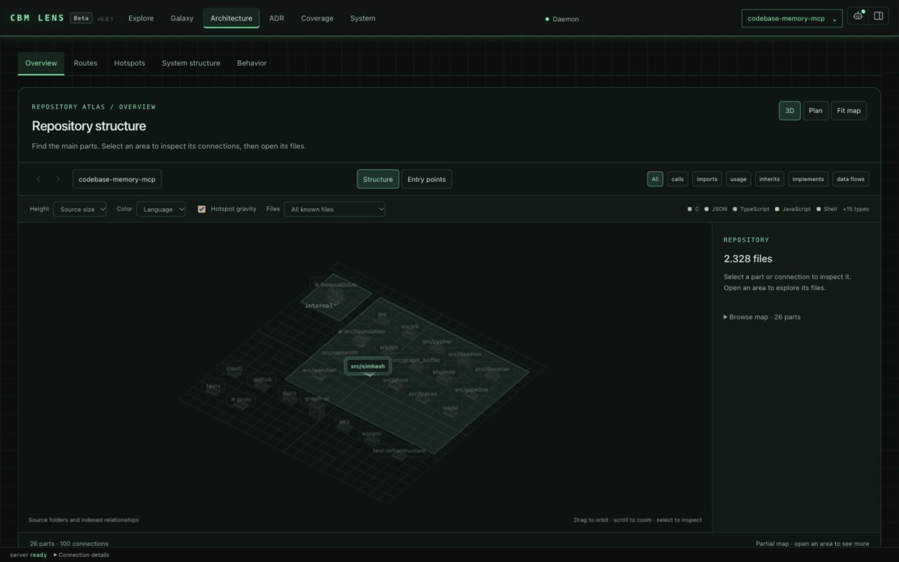
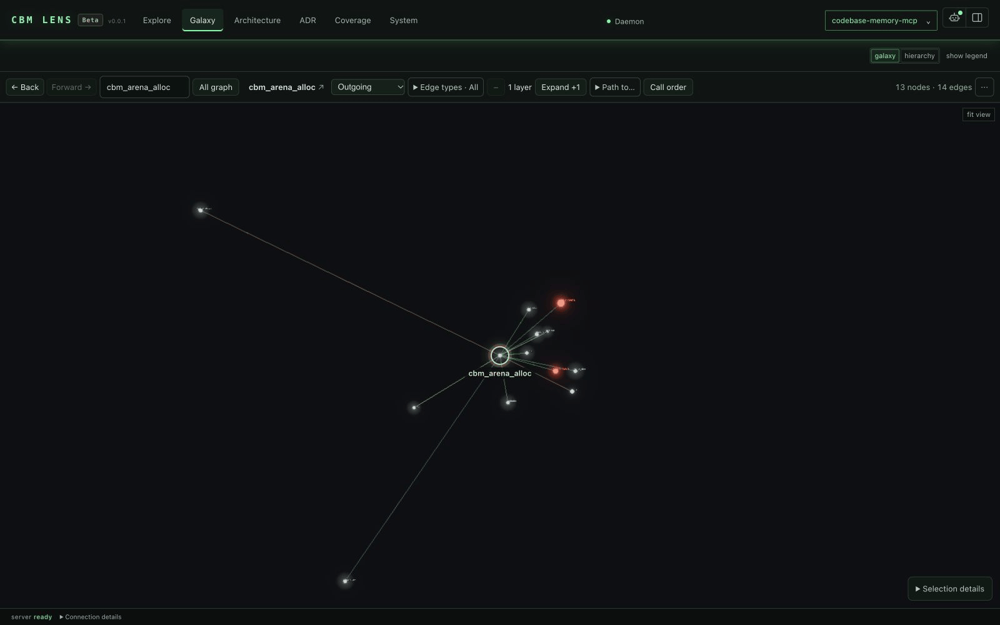
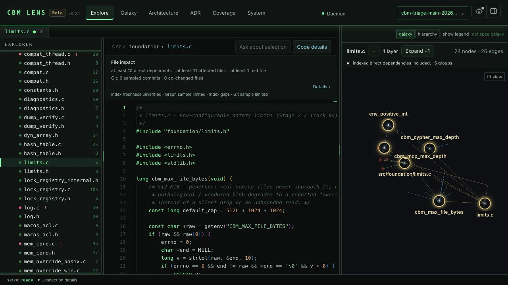
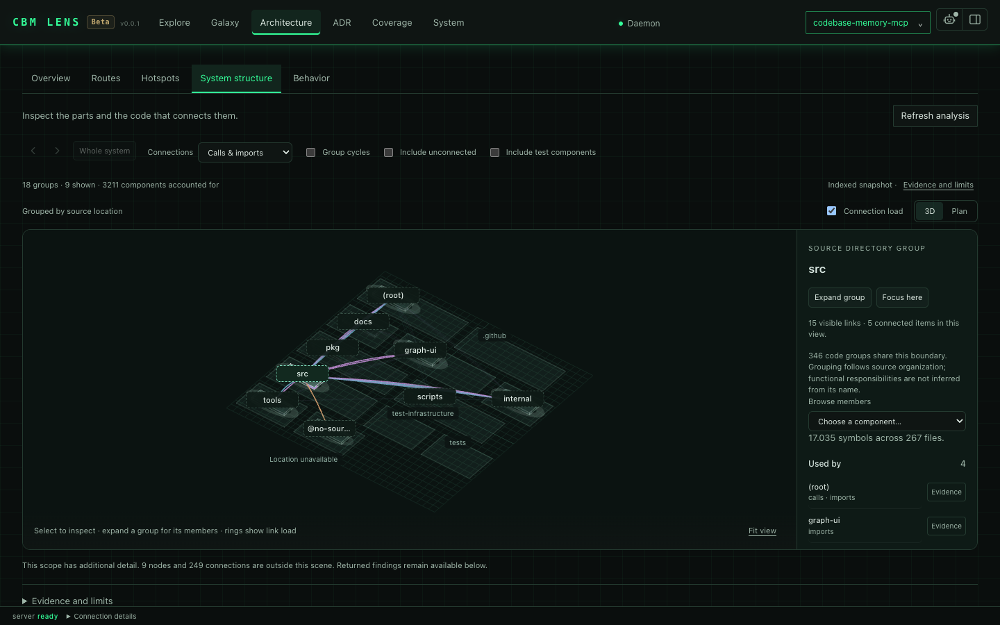
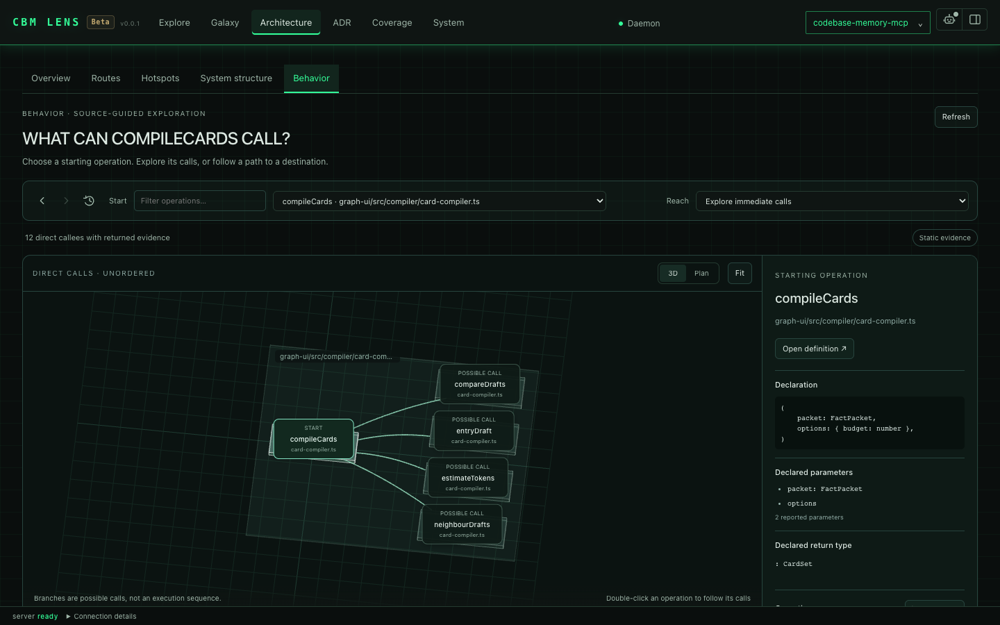
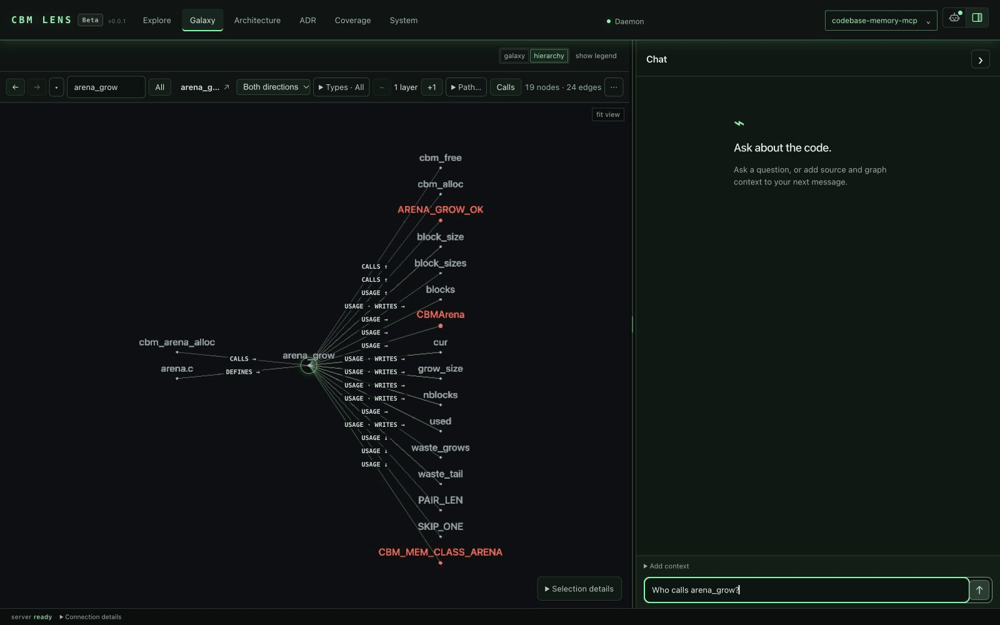

# Mori (森)

Mori is a local code graph for coding agents. It parses your repositories
with Tree-sitter, resolves calls with typed, LSP-style resolution, and keeps
the result in a persistent SQLite graph, a code memory that survives between
sessions. Agents query it over the Model Context Protocol (MCP) as server
`mori-graph`; you can query the same graph from the command line.

Mori also links code across repositories. After a link run, the graph shows
which client repo calls which HTTP route, gRPC method, channel, or GraphQL
field in another repo, down to the gqlgen resolver that answers a GraphQL
field.

Indexing and queries run on your machine. They need no hosted service, API
key, or language runtime, and the parser grammars are compiled into the
binary.

<p align="center">
  
</p>

- [What Mori Answers](#what-mori-answers)
- [Install](#install)
- [Register the MCP Server](#register-the-mcp-server)
  ([Hooks and Tool Profiles](#hooks-and-tool-profiles))
- [Index and Query](#index-and-query)
- [CLI](#cli)
- [Graph UI](#graph-ui)
- [Cross-Repo Linking](#cross-repo-linking)
- [Configuration](#configuration)
- [MCP Tools](#mcp-tools)
- [Graph Data Model](#graph-data-model)
- [Hybrid LSP](#hybrid-lsp)
- [Language Support](#language-support)
- [Performance](#performance)
- [Troubleshooting](#troubleshooting)
- [Build](#build), [Test](#test), and [Release](#release)
- [Credits](#credits)

## What Mori Answers

Ask your agent a structural question and it calls a graph tool instead of
reading files one by one:

```text
You: "what calls ProcessOrder?"
Agent calls: trace_path(function_name="ProcessOrder", direction="inbound")
Mori: runs the graph query and returns the callers
Agent: presents the call chain
```

Mori builds and queries the graph; it runs no generative model. Your MCP
client is the part that turns a question into tool calls.

**Code structure.** Callers and callees across files and packages, with
import-aware, type-inferred call resolution. `get_architecture` summarizes
languages, packages, routes, hotspots, clusters (Louvain community detection
over call edges), and cycles. Cypher-like queries cover the rest:
`MATCH (f:Function)-[:CALLS]->(g) WHERE f.name = 'main' RETURN g.name`.

**Search.** `search_graph` combines regex name patterns, label and degree
filters, BM25 full-text search (SQLite FTS5 with a camelCase and snake_case
aware tokenizer), and semantic search through its `semantic_query`
parameter. Semantic search uses Nomic `nomic-embed-code` embeddings compiled
into the binary, so it needs no API key, Ollama, or Docker. `search_code` is
a grep over indexed files only.

**Change impact.** `detect_changes` maps uncommitted changes to affected
symbols with a risk class, and reports test impact with `scope: "tests"`.
`compare_graphs` compares two indexed snapshots. Dead-code candidates are
functions with no indexed callers, excluding entry points; check dynamic
dispatch, coverage gaps, and framework conventions before deleting one.

**Documentation next to code.** Markdown, reStructuredText, and AsciiDoc
become document sections, and PDFs with a text layer become searchable pages
(no OCR). Doc comments and document references that resolve to one
definition become `MENTIONS` edges. Architecture decision records contribute
status, deciders, and supersession, and `manage_adr` keeps one decision
document per project across sessions.

**Infrastructure and deployment.** Mori connects Dockerfiles, Compose
services, Kubernetes resources, Helm charts, Kustomize overlays,
Terraform and OpenTofu, Terragrunt, Ansible, shell scripts, Make targets,
and CI steps to the source they build and run. For resolvable inputs, a
trace follows Service, workload, image, Dockerfile, then program. Dynamic
values and unresolved templates leave gaps; see
[Edge Rules for Infrastructure](#edge-rules-for-infrastructure).

**Services and repositories.** HTTP routes match their call sites with a
confidence score. Mori detects gRPC, GraphQL, and tRPC services, and
Socket.IO, EventEmitter, and generic pub-sub channels (`EMITS`,
`LISTENS_ON`) in eight languages. A link run joins these across indexed
repositories with `CROSS_*` edges; see
[Cross-Repo Linking](#cross-repo-linking).

**Runtime observations.** `ingest_traces` stores observed call paths from
traces you collect separately, next to the static graph. A static call path
alone does not show what ran.

**Test selection (experimental).** Mori can choose which C and C++ tests a
change reaches from static reachability plus per-test coverage, falling back
to running everything when evidence is missing. See
[docs/SMART_CI.md](docs/SMART_CI.md).

A graph answer is a lead, not proof. Before treating a missing result as
"nothing uses this", call `check_index_coverage` for the paths involved: a
clean result means no recorded gap, not a complete index.

## Install

Mori ships as `mori/v*` releases of
[Unique-Divine/jiyuu](https://github.com/Unique-Divine/jiyuu/releases).
Releases that package `mori` have archives named
`mori-<version>-<target>.tar.gz`, plus `checksums.txt` and build provenance
attestations.

| Target | Platform |
| --- | --- |
| `linux-x64` | Linux x86-64, static |
| `linux-arm64` | Linux ARM64, static |
| `darwin-arm64` | macOS on Apple silicon, macOS 14 or later |
| `darwin-x64` | macOS on Intel, macOS 14 or later |

An archive holds the executable, licenses, and notices. Mori 0.14.0
ships the `mori` executable and keeps the MCP key `mori-graph`.

There are no Windows builds.

### Install With mise

mise's `github:` backend picks the archive for your platform:

```toml
# ~/.config/mise/config.toml
[tools."github:Unique-Divine/jiyuu"]
version = "0.14.0"
version_prefix = "mori/v"
```

```sh
mise install
mori --version  # mori 0.14.0
```

For a published release with a `mori` archive, pin its version and run
`mori --version`. With `lockfile = true`, lock the platforms you use before
installing. For a release with all four targets:

```sh
mise lock --platform linux-arm64,linux-x64,macos-arm64,macos-x64
```

To upgrade, stop the background daemon with the current executable, then
bump `version`, relock, and run `mise install`. The next session starts the
daemon for the selected version:

```sh
mori daemon stop
```

Remove any hand-built binary earlier on `PATH` (for example in
`~/.local/bin`), or it keeps shadowing the release.

### Upgrade From C 0.13.1

Install Mori 0.14.0 and stop the 0.13.1 daemon with the old executable
and the environment it used. Keep the MCP key `mori-graph` and point its
command and any `hook-augment` commands at the same `mori` shim. Open a new
client session and check a graph query before retiring the old setup.

To roll back, stop the Mori 0.14.0 daemon, restore the 0.13.1 mise pin and
lock, and restore the previous MCP and hook command paths and cache
settings. Release `mori/v0.13.1` ships `codebase-memory-mcp` for Linux x64
and arm64 and macOS arm64.

### Download a Release

Download the archive for your target from the
[releases page](https://github.com/Unique-Divine/jiyuu/releases), check it
against `checksums.txt`, and put its executable on your `PATH`. For a
release that packages `mori`, set `binary=mori` and use its published version.

```sh
version=0.14.0 target=linux-x64 binary=mori
gh release download "mori/v$version" --repo Unique-Divine/jiyuu \
  --pattern "$binary-$version-$target.tar.gz" --pattern checksums.txt
sha256sum --check --ignore-missing checksums.txt
tar -xzf "$binary-$version-$target.tar.gz" "$binary"
install -m 755 "$binary" "$HOME/.local/bin/$binary"
```

On macOS, use `shasum -a 256 --check --ignore-missing checksums.txt`.

To check that GitHub Actions in Jiyuu built an archive, verify its
attestation:

```sh
gh attestation verify "$binary-$version-$target.tar.gz" --repo Unique-Divine/jiyuu
```

The macOS binaries have an ad-hoc signature, not a Developer ID signature,
and are not notarized. Downloads through mise, `curl`, or
`gh release download` carry no quarantine attribute and run as is. If you
download the archive in a browser, macOS Gatekeeper refuses to open the
binary because Apple can't verify it. Remove the quarantine attribute after
unpacking:

```sh
xattr -d com.apple.quarantine "$binary"
```

Use mise or a release archive for binary installation and upgrades.
The 0.13.1 executable also has inherited installer and updater commands
that contact the upstream project's releases.

## Register the MCP Server

Run `mori` with no arguments and it serves MCP over stdio. Register it once
per client under the key `mori-graph`. Use a path that survives upgrades,
such as the mise shim:

```sh
claude mcp add --scope user mori-graph -- ~/.local/share/mise/shims/mori
codex mcp add mori-graph -- ~/.local/share/mise/shims/mori
```

The examples use the `mori` shim. On 0.13.1, use the
`codebase-memory-mcp` shim. If the client cannot use a shim, register the
path from `mise which` for that executable and update it after each upgrade.

To switch an existing `mori-graph` registration, update its command in
the client config and keep its arguments and environment. The `mori`
shim path stays the same across Mori upgrades. To roll back across the
rename, restore the previous `codebase-memory-mcp` command and hook paths.
If `mori install --help` lists the new registration behavior, it can add
a fresh Claude Code or Codex entry using the running binary's absolute path.

For clients configured through JSON, such as `~/.claude.json` or a project
`.mcp.json`:

```json
{
  "mcpServers": {
    "mori-graph": {
      "command": "/absolute/path/to/mori",
      "args": []
    }
  }
}
```

Restart the agent. The key names the tools, so they appear as
`mcp__mori-graph__search_graph` and so on; `/mcp` in Claude Code lists 17
of them. Use the same key in hook matchers, permission rules, and agent
profiles that list tools.

Agent skill [`mori-graph`](../ai-skills/mori-graph/SKILL.md) in this
repository teaches an agent when to reach for each tool, how to check index
freshness, and how much evidence to gather before claiming absence.

### Hooks and Tool Profiles

The command `mori hook-augment` reads a hook payload on standard input and
adds graph context. At session start it names the indexed project or explains
how to index the working directory. The hook needs a running Mori daemon
and exits successfully when it cannot supply context.

#### Codex CLI

To add context at session start, append this matcher group to
`hooks.SessionStart` in `~/.codex/hooks.json`, or in `$CODEX_HOME/hooks.json`
if you set `CODEX_HOME`. Create the `hooks` object and `SessionStart` array
if they are missing. Use the same executable and cache settings as the
`mori-graph` MCP server.

```json
{
  "matcher": "startup|resume|clear|compact|fork",
  "hooks": [
    {
      "type": "command",
      "command": "/home/you/.local/share/mise/shims/mori hook-augment",
      "timeout": 5
    }
  ]
}
```

Open Codex, review and trust the Mori command in the `/hooks` menu, then
start a fresh session. If the daemon is down at session start, run
`mori daemon start` with the same executable and cache settings before
opening Codex.

From the Jiyuu repository root, run the smoke test to check context delivery
with your installed Codex CLI. The test uses a temporary Codex configuration,
a private Mori cache, and a local mock model endpoint.

```sh
python3 mori/tests/smoke_codex_session_hook.py --mori "$(mise which mori)"
```

#### Claude Code

The Claude Code hooks also add matching symbols before a search, coverage
warnings after a file read, and context at subagent start. Add these entries
to `~/.claude/settings.json` using the binary path you registered.

```json
{
  "hooks": {
    "PreToolUse": [
      {"matcher": "Grep|Glob|Bash",
       "hooks": [{"type": "command", "command": "/home/you/.local/share/mise/shims/mori hook-augment", "timeout": 5}]}
    ],
    "PostToolUse": [
      {"matcher": "Read|mcp__.*(mori-graph|codebase-memory-mcp)__.*",
       "hooks": [{"type": "command", "command": "/home/you/.local/share/mise/shims/mori hook-augment", "timeout": 5}]}
    ],
    "SessionStart": [
      {"matcher": "startup|resume|clear|compact",
       "hooks": [{"type": "command", "command": "/home/you/.local/share/mise/shims/mori hook-augment", "timeout": 5}]}
    ],
    "SubagentStart": [
      {"matcher": "*",
       "hooks": [{"type": "command", "command": "/home/you/.local/share/mise/shims/mori hook-augment", "timeout": 5}]}
    ]
  }
}
```

When migrating an existing Claude Code setup, update the hook executable
path and the legacy graph-tool `PostToolUse` matcher. With a Mori build
that recognizes both keys, the matcher above lets a graph call reset
the reminder after repeated searches. Keep the original matcher for a
rollback to the legacy executable.

`--tool-profile` limits the tools a server exposes, for subagents that
should only read the graph. Register a second key with the profile:

```sh
claude mcp add --scope user mori-graph-scout -- ~/.local/share/mise/shims/mori --tool-profile=scout
```

| Profile | Tools |
| --- | --- |
| `scout` | `search_graph`, `trace_path`, `get_code_snippet`, `get_file_outline`, `get_architecture`, `list_projects`, `index_status`, `check_index_coverage` |
| `analysis` | The `scout` tools plus `query_graph`, `get_graph_schema`, `compare_graphs`, `search_code`, and `detect_changes` |

Neither profile can index, delete projects, write the ADR, or ingest traces,
and a profiled server never serves the graph UI.

## Index and Query

Ask the agent to "index this project", or index from a shell:

```sh
mori cli index_repository --repo-path /absolute/path/to/repo
mori cli list_projects
```

Each project gets a name derived from its path; pass that `name` as
`project` in later queries. Indexes live in
`${CBM_CACHE_DIR:-~/.cache/codebase-memory-mcp}` and persist across restarts
(SQLite in WAL mode). Delete one with `delete_project`, or remove the cache
directory to reset everything.

`index_repository` takes a `mode`:

| Mode | Use it for |
| --- | --- |
| `full` | Full indexing with semantic analysis. The default. |
| `moderate` | A filtered index with semantic analysis. |
| `fast` | A filtered index without semantic analysis. |
| `cross-repo-intelligence` | A link run across indexed projects, optionally limited by `target_projects`. |

Before indexing a large repo, keep data and build output out of the graph
with a `.cbmignore` file at the repo root (gitignore syntax). JSON keys alone
can outnumber code nodes ten to one. See
[Ignoring Files](#ignoring-files).

### Long Indexes

A synchronous `index_repository` on a large repo can outlast a client's
per-call deadline. When the client gives up, the daemon cancels an index
nobody else is waiting for, so retrying the same blocking call never
finishes. Use async mode:

1. `index_repository(repo_path="/abs/path", async: true)` starts the index in
   the daemon, or joins the one already running for that project, and
   returns `state` (`queued` or `running`). The job keeps running if the
   client cancels, times out, or disconnects.
2. `index_repository(repo_path="/abs/path", status: true)` reports `state`
   (`queued`, `running`, `cancelling`, `succeeded`, `failed`, `cancelled`),
   `started_at`, `finished_at`, and an `error` summary. Poll until it
   finishes. Pass the same `repo_path`, and `name` if the index call used
   one.

`async` and `status` are exclusive, and `async` doesn't apply to link runs.
A daemon that a session started on demand stops, and cancels its jobs, when
its last client disconnects. A one-shot `mori cli index_repository --async`
that is the daemon's only client is refused for that reason: run
`mori daemon start` first, keep an MCP session open, or drop `--async`.

### Keeping Indexes Fresh

A background watcher re-indexes projects that active MCP sessions registered:
the session's root project when it connects, and every target of a
successful `index_repository` call from that session. A watch lasts while at
least one owning session is connected; under a daemon started with
`mori daemon start`, it lasts until that daemon stops. CLI indexing and
failed indexes register no watch. `index_status` reports the watch in its
`watch` object.

After a successful cross-repo link run, the watcher reuses the project's
target selection when it reindexes. The caller's `index_status` reports
`cross_repo.status` as `stale` when a provider changes or disappears, or
when the stored link run predates provider generation tracking. Run
cross-repo linking again to refresh those links. The field
`cross_repo.reverse_pending` indicates that the daemon still needs to
update the target graphs' references to this caller.

The watcher follows git projects only, unless `watch_non_git` is on. Linked
git worktrees are indexed as their own projects unless `ignore_worktrees` is
on, which helps when short-lived worktrees would each leave an index behind.

To index new projects automatically when a session connects:

```sh
mori config set auto_index true
mori config set auto_index_limit 50000   # skip repos with more files
```

`auto_index` is off by default. See [Configuration](#configuration) for
`auto_watch`, `watcher_enabled`, and the other settings.

### Existing-Generation Routing

Set `MORI_IMPL_INDEX_ROUTE=rust` when starting the daemon, or use a fresh
`CBM_RUNTIME_DIR` so the worker inherits the setting. Rust selects the
existing-generation route for an ordinary reindex. An exact live match
ends the run without a copy. After C loads the staged manifest, Rust
selects no-op, closure repair, full rebuild, or fatal failure. The
`pipeline.index_route` worker log records the Rust decision. Use
`CBM_PROFILE=1` to keep worker logs.

C is the default for route selection. It owns the proofs and executes
the selected route. `MORI_IMPL_INDEX_MANIFEST` selects the exact
manifest comparison independently.

### Full-Build Scheduling

Rust schedules the top-level full-build passes by default in the linked
`mori` executable. It chooses parallel extraction when discovery supplies
more than 50 files and the effective worker count exceeds one. Frozen
builds use one worker. The `pipeline.full_build_driver` worker log records
Rust scheduling.

C executes the passes, including extraction and resolution. Standard local
linked builds accept `MORI_IMPL_FULL_BUILD_DRIVER=c` on a fresh daemon.
Packaged builds contain the Rust scheduling driver. Rust scheduling also
works with
`MORI_IMPL_GRAPH_WRITER=rust` when the linked build supports that writer.

### Source Publication

After source indexing stages a graph, Rust handles the publication
decisions by default in the linked `mori` executable. The
`pipeline.source_publish` worker log records the staged result and Rust
selection. Rust orders the checks through the publication lease. C owns
the stage and the file transaction, including destination preparation,
rename, and rollback. Standard local linked builds accept
`MORI_IMPL_SOURCE_PUBLISH=c` on a fresh daemon. Packaged builds contain the
Rust publication decision driver. Use the prior archive to roll back both
packaged driver changes.

### Index Worker Recovery

Set `MORI_IMPL_JOB_RECOVERY=rust` when starting the daemon to run the
Rust worker recovery driver. It enforces the retry budget and decides
when the daemon can attempt a partial index after a contained worker
failure. The debug log event `daemon.index.recovery_driver` identifies
the backend. The default driver is C.

### Named Watch Reconciliation

Set `MORI_IMPL_NAMED_WATCH=rust` when starting a permanent daemon to select
the Rust reconciler for named watch snapshots. It validates the complete
snapshot before applying it and rolls back additions if registration fails.
The debug log event `daemon.named_watch.reconcile` identifies the backend.
C remains the default.

### Provider Repair Recovery

On a permanent daemon with provider repair enabled, set
`MORI_IMPL_REPAIR_RECOVERY=rust` at startup to opt into the Rust recovery
scheduler. The daemon log event `cross_repo.recovery_driver` identifies
the backend. Both schedulers use the same saved graph state, mutation
lease, and native repair operations. The C scheduler remains the default.

### GraphQL SDL Extraction

Set `MORI_IMPL_GRAPHQL_EXTRACT=rust` when starting the daemon to select Rust
for GraphQL schema field spans, operation roots, and parser input escape masking.
Both paths use the same Tree-sitter parser and the original source bytes
for field metadata. The worker log records both callbacks at debug level.

### Markdown Heading Extraction

Set `MORI_IMPL_MARKDOWN_EXTRACT=rust` to select Rust heading text extraction.
The implementation borrows the same Tree-sitter tree to read ATX and Setext
headings. Section identity, body extraction, and document linking are C.

### Python Import Extraction

Set `MORI_IMPL_PYTHON_IMPORTS=rust` when starting the daemon to read Python
import statements through Rust. The worker debug event
`extract.python_imports` identifies the backend. C emits the arena rows,
applies the annotation-only import rules, and resolves names across files.

### Sharing a Graph With a Team

`index_repository` with `persistence: true` writes
`.codebase-memory/graph.db.zst` next to your source: a zstd-compressed
SQLite snapshot of the graph, typically 8 to 13 times smaller than the
database. Later indexes refresh it. When a teammate indexes a clone that has
the artifact and no local index, Mori imports it first and then indexes only
what changed.

- The first export writes `.codebase-memory/.gitattributes` with
  `merge=ours`. Check your Git merge-driver setup before relying on it.
- Every index rewrites the artifact, including the watcher's, and Git stores
  each rewrite as a new blob. Commit it at a chosen cadence, such as a
  release or a nightly job, not on every change. One team reached about
  6 GB of history across 350 commits of this one path.
- To move it through Git LFS, track only the `.zst` from the repo-root
  `.gitattributes` and leave the generated `.codebase-memory/.gitattributes`
  in place:

  ```gitattributes
  .codebase-memory/graph.db.zst filter=lfs diff=lfs merge=lfs -text
  ```

  Every teammate then needs `git lfs install`; without it the checkout holds
  a pointer file, the import rejects it, and Mori falls back to a full index.
- Add `.codebase-memory/` to `.gitignore` if you'd rather everyone index
  from scratch.

### The Shared Daemon

Every Mori session on an account shares one coordination daemon: MCP
servers, hooks, and one-shot CLI commands all connect to it, and the first
one starts it. The daemon owns watchers, shared indexing jobs, and the graph
UI. A daemon started by a session stops after the last session closes; one
started with `mori daemon start` keeps running until `mori daemon stop`.
`mori daemon status` shows its state.

All running Mori processes must be the same build and use the same cache
directory. A conflicting process fails before doing any work and records
the conflict in `${CBM_CACHE_DIR}/logs/daemon-conflicts.ndjson`. After an
upgrade, stop the daemon and restart open agent sessions.

The daemon logs to `${CBM_CACHE_DIR}/logs/cbm-daemon.log`. Environment that
the daemon uses, such as `CBM_DIAGNOSTICS` and logging and resource
settings, comes from the session that started it. To change it, close every
session so the daemon exits, update the agent configs, and start again.

## CLI

Every MCP tool also runs as a one-shot command. `mori cli <tool> --help`
lists the flags generated from that tool's input schema:

```sh
mori cli index_repository --repo-path /path/to/repo
mori cli list_projects

# Use the "name" from list_projects as the project value.
mori cli search_graph --project my-project --name-pattern '.*Handler.*' --label Function
mori cli trace_path --project my-project --function-name Search --direction both
mori cli query_graph --project my-project --query 'MATCH (f:Function) RETURN f.name LIMIT 5'

# Machine-readable output.
mori cli --quiet list_projects --format json
mori cli list_projects --format json --detail stats | jq '.projects[].name'
```

Tools that need arguments also accept JSON on stdin or through `--args-file`:

```sh
echo '{"repo_path":"/path/to/client","mode":"cross-repo-intelligence","target_projects":["server"]}' |
  mori cli --quiet index_repository
```

Output options go before the tool name:

| Option | Effect |
| --- | --- |
| `--quiet` | Errors only; no progress. |
| `--progress` | Progress on stderr even when stderr is redirected. |
| `--verbose` | Add informational logs. |
| `--json` | Print the full MCP result envelope. |

Progress and logs go to stderr; stdout carries only the result. Read tools
print a compact tree by default; a tool's `--format json` prints its payload
as JSON. A CLI command joins the shared daemon, starting one if needed, for
the length of the command, and never registers a watch.

Results are paged. `search_graph` returns 50 rows per page and
`query_graph` stops at an output budget; both report `has_more` and a
continuation offset or cursor. Page to the end before counting or claiming
absence. `max_output_tokens` caps a response at four UTF-8 bytes per
requested token. A value that is not valid UTF-8 comes back as
`@bytes:<hex>`, and a valid value that starts with `@bytes:` or `@utf8:`
comes back prefixed with `@utf8:`.

Other commands:

```sh
mori config list            # settings; see Configuration
mori daemon start           # keep a daemon warm; also serves the graph UI
mori daemon status
mori daemon stop
mori --version
```

## Graph UI

The graph UI is a browser app for reading source beside the graph. It came
from upstream as CBM Lens, built on
[CodeAtlasWeb](graph-ui/README.md) by
[Bernhard Jackiewicz](https://github.com/BernhardJackiewicz), and the app
still shows that name. It runs on loopback and edits nothing in your
repositories.

Release binaries embed the UI. Start a daemon that serves it:

```sh
mori daemon start --open --port=9749
```

The browser opens `http://127.0.0.1:9749`. A permanent daemon keeps the UI
up after the command exits; stop it with `mori daemon stop`. An MCP session
started with `--ui=true --port=9749` serves the same UI.

To try UI changes from a Jiyuu checkout, build a binary with the UI
embedded (needs Node.js 22 or later):

```sh
cd mori
just grammars
scripts/build.sh --with-ui
build/c/codebase-memory-mcp daemon start --open --port=9749
```

All clients of one daemon must run the same build, so stop the release
daemon first, or give the dev build its own `CBM_CACHE_DIR` and
`CBM_RUNTIME_DIR`.

To open a repository, choose **Add project index** in the project menu
(`Alt+P`), pick a local folder, and name the index. Files stay in place.
Bookmark a view with `?project=<name>&workspace=<workspace>`:

| Workspace | What you can do |
| --- | --- |
| `explore` | Browse the file tree and read source in Monaco. File impact shows what depends on the open file; Code details shows callers, calls, references, and related tests of the symbol under the caret. |
| `galaxy` | Search graph nodes (`Cmd+K` or `Ctrl+K`), load neighbors layer by layer, switch to the hierarchy, follow a path, and open source. |
| `repos` | See indexed repositories as spheres and their cross-repo links as arcs, colored by link type. Click an arc to list the links behind it, or a sphere to narrow the list to one repo. |
| `architecture` | A 3D folder map with entry points, routes, hotspots, system structure, and behavior paths. |
| `adr` | Read and edit the project's decision document, the one `manage_adr` uses. Saving changes the index, not a file in your repo. |
| `coverage` | Indexed, partially parsed, skipped, and excluded paths, with freshness. |
| `system` | Daemon activity, indexes, and logs, filterable by project, severity, or text. |

**Galaxy.** The recording follows the outgoing relationships of
`cbm_arena_alloc` one layer further, switches to the hierarchy, and shows
the two-hop call path to `cbm_alloc`. Edge pulses show direction, not live
execution. [Still image](docs/images/lens-galaxy.jpg).

<p align="center">
  
</p>

**Explore.** Source in Monaco with the graph alongside.

<p align="center"></p>

**Repos.** The Repos workspace reads every project index in the cache
directory through two read-only endpoints, `GET /api/xrepo/summary` and
`GET /api/xrepo/links`, and counts each link once, from the repository that
uses an entry point to the one that provides it. A target that has no index
of its own still gets a sphere, marked "not indexed". Run link runs first
(see [Cross-Repo Linking](#cross-repo-linking)), then press **Refresh**.

<details>
<summary>Architecture views: structure and behavior</summary>

- **Overview** moves through source folders and files on a 3D map, with
  source-size or uniform height and relationship filters. Entry points
  follows a static call graph from a starting symbol.
- **Routes** switches between the service map and endpoint connections.
- **Hotspots** ranks symbols by measured signals such as fan-in and
  complexity. It is not a code-quality score.
- **System structure** groups symbols into components and shows their
  dependencies, with cycles isolated.
- **Behavior** shows static call paths between a source and a reachable
  destination, with the statements behind them. These are possible paths,
  not a recorded execution order.

<p align="center"></p>

<p align="center"></p>

Drag to orbit and scroll to zoom. Large views state their limits and how
many items they left out, so a missing edge can be a display limit; check
Coverage and the source.

</details>

### Local Chat

**Chat** at the top right answers questions about the code in view: the
open file or selected text in Explore, or the selected node and its loaded
neighbors in Galaxy. Caller and callee questions, such as "Who calls
cbm_pipeline_run?", are answered from the graph without a model, and the
answer says so.

For other questions, open the agent configuration (the robot icon) and
choose a model. The default, Qwen2.5 Coder 0.5B, is a 567 MB download from
Hugging Face; Qwen3 0.6B, LFM2.5 1.2B, and Qwen3.5 2B are larger. All need
WebGPU with `shader-f16`. Inference runs in the browser, and nothing is sent
to a hosted API. Chat history stays in the browser for 24 hours per project.
The chat explains the context you give it; it can't edit files or run
tools, and the small default model words things loosely.

<p align="center"></p>

The recordings show the UI on upstream's own source in October 2026;
[docs/images/README.md](docs/images/README.md) records each capture.
For logs, frontend development, and the experimental agent-activity view,
see [graph-ui/README.md](graph-ui/README.md).

## Cross-Repo Linking

A link run is separate from indexing and reads no source files: it matches
entry points that one indexed project uses against the ones another
provides, and stores `CROSS_*` edges (`CROSS_HTTP_CALLS`,
`CROSS_GRPC_CALLS`, `CROSS_GRAPHQL_CALLS`, `CROSS_TRPC_CALLS`,
`CROSS_ASYNC_CALLS`, `CROSS_CHANNEL`) in both projects.

```sh
echo '{"repo_path":"/path/to/client-repo","mode":"cross-repo-intelligence","target_projects":["server-project"]}' |
  mori cli --quiet index_repository
```

- **One run per project, every target in it.** A link run replaces that
  project's earlier links, so a client that calls two servers lists both in
  `target_projects`.
- **Name the target** when two servers share field or route names.
  `["*"]` works when names are unique across projects; it skips indexes too
  old to link and lists them under `skipped_projects`.
- **Check the result.** `index_status` reports `cross_repo.status` as
  `never_run` before the first link run and `ran` after a link run. It also
  reports the targets, outcome, and edge count. A client reindex recomputes
  links using its saved targets. If a provider changes and the client
  reports `stale`, rerun the link command for that client.

### GraphQL Clients and gqlgen Resolvers

Mori links a GraphQL client operation to the server field it reaches. Both
sides use the field path, an operation kind followed by field names, such
as `Query.perp.trades`:

```text
server: schema files (.graphql, .graphqls)    client: operation text
  type Query { perp: Perp! }                    query OpenTrades {
  type Perp { trades(...): [PerpTrade!]! }        perp { trades(...) { id } } }
        |                                               |
Route __graphql__Query.perp          <--- GRAPHQL_CALLS (field_path "perp")
Route __graphql__Query.perp.trades   <--- GRAPHQL_CALLS (field_path "perp.trades")
        ^ HANDLES                          CROSS_GRAPHQL_CALLS after linking
perpResolver.Trades (gqlgen) or the schema Field
```

- **Server Routes** come from schema files: each root field of `Query`,
  `Mutation`, and `Subscription`, and one level below it. A Route records
  the declared type and `deprecated` with its reason.
- **Handlers** are gqlgen resolver methods, with ownership read from
  `gqlgen.yml`. Fields bound to struct members, and servers that don't use
  gqlgen, fall back to the schema `Field`.
- **Client edges** come from operation text in string literals, template
  literals, Python triple-quoted strings, codegen `graphql()` documents,
  module constants, and `{ query }` objects.
- **Not linkable:** queries assembled at runtime from field lists, and SDK
  calls that hold no GraphQL text.

Which client code reaches a field:

```cypher
MATCH (c)-[r:GRAPHQL_CALLS]->(rt:Route {qualified_name: "__graphql__Query.perp.trades"})
RETURN c.name, c.file_path, r.operation LIMIT 100
```

Who uses a resolver, from the server project:

```cypher
MATCH (h)-[:HANDLES]->(rt:Route)<-[x:CROSS_GRAPHQL_CALLS]-()
WHERE h.name = "Trades" AND rt.qualified_name = "__graphql__Query.perp.trades"
RETURN rt.name, h.name, h.file_path, x.callers LIMIT 100
```

The provider stores caller records in `x.callers`, keyed by client project
and qualified name. Each record includes the caller's function and file.
The C query engine returns at most 511 bytes when projecting `x.callers`.
A larger caller map can appear as truncated JSON.

Map schema files if your build doesn't already, with
`{"extra_extensions": {".graphqls": "graphql"}}` (see
[Custom File Extensions](#custom-file-extensions)). Avoid `gql` as a path
segment of an indexed repo: Mori recognizes GraphQL calls by library names
in qualified names, so a `gql` directory makes every call in it look like a
GraphQL call. The agent skill's
[GraphQL reference](../ai-skills/mori-graph/references/graphql.md) has more
queries.

## Configuration

Runtime settings live in the cache directory and are managed with
`mori config`:

```sh
mori config list                          # show all settings
mori config set auto_index true           # index new projects on session start
mori config set auto_index_limit 50000    # max files for auto_index
mori config set auto_watch false          # remove all background watches (default: true)
mori config set ignore_worktrees true     # skip linked git worktrees on automatic paths (default: false)
mori config set doc_candidates false      # skip doc-to-code candidate scoring on huge repos
mori config set watcher_enabled false     # never start the watcher thread (default: true)
mori config set watch_non_git true        # also poll roots that aren't git repos (default: false)
mori config set index_max_files 250000    # optional per-index source-file limit
mori config set index_max_source_mb 16384 # optional per-index source-size limit
mori config set index_max_rss_mb 8192     # optional worker memory limit
mori config set index_max_duration_seconds 3600 # optional per-index time limit
mori config reset auto_index              # back to the default
```

`watcher_enabled` and `watch_non_git` are read when the daemon starts, so
run `mori daemon stop` after changing them. The `index_max_*` limits are off
by default; exceeding one fails the whole index run and keeps the previous
index serving. See [docs/INDEX_RESOURCE_LIMITS.md](docs/INDEX_RESOURCE_LIMITS.md).
[docs/CONFIGURATION.md](docs/CONFIGURATION.md) lists every file Mori reads
or writes and how settings take precedence.

### Environment Variables

The variable names and default paths come from the imported code and keep
its `CBM_` prefix and `codebase-memory-mcp` directory names.

| Variable | Default | Description |
| --- | --- | --- |
| `CBM_CACHE_DIR` | `~/.cache/codebase-memory-mcp` | Where indexes, `_config.db`, logs, and UI settings live. One account uses one cache directory at a time; close running sessions before switching. |
| `CBM_ALLOWED_ROOT` | unset | Refuse to index any path that resolves outside this directory, through MCP or the UI. Useful when an untrusted caller drives the server. |
| `CBM_DIAGNOSTICS` | `false` | Set to `1` to have the daemon write `snapshot.json` and a retained `trajectory.ndjson` of memory counters every 5 seconds to a private directory under the system temp directory. The `diagnostics.start` event in the daemon log names it. |
| `CBM_LOG_LEVEL` | `warn` for frontends, `info` for the daemon | `debug`, `info`, `warn`, `error`, or `none`. |
| `CBM_WORKERS` | detected | Parallel indexing workers, 1 to 256. Set it in containers where the CPU count reports the host. |
| `CBM_MEM_BUDGET_MB` | detected | In-memory graph budget in MiB, clamped to total RAM. |
| `CBM_DUMP_VERIFY_MIN_RATIO` | `0.5` | After indexing, report `status: "degraded"` when the persisted node count falls below this fraction of the in-memory count. `0` disables the check. |

When running a development build against real repositories, point
`CBM_CACHE_DIR` and `CBM_RUNTIME_DIR` at scratch directories to keep its
indexes apart from your release install.

### Ignoring Files

Discovery skips paths in layers: a built-in list (`.git`, `node_modules`,
and others), the repo's `.gitignore` files, then `.cbmignore` at the root of
the indexed directory (gitignore syntax). Symlinks are always skipped. In a
repo you don't own, keep `.cbmignore` out of Git:

```sh
echo /.cbmignore >> "$(git rev-parse --git-path info/exclude)"
```

[docs/cbmignore.md](docs/cbmignore.md) covers the syntax, the order of the
layers, and how negation works across them.

### Custom File Extensions

JSON config files map extra file extensions to supported languages, for
framework extensions like `.blade.php` or schema files like `.graphqls`.
Project config overrides global config for the same extension.

```json
// .codebase-memory.json at the repo root
{"extra_extensions": {".blade.php": "php", ".mjs": "javascript"}}
```

```json
// ~/.config/codebase-memory-mcp/config.json (or $XDG_CONFIG_HOME/codebase-memory-mcp/config.json)
{"extra_extensions": {".twig": "html", ".graphqls": "graphql"}}
```

Extensions must start with `.`. Language names match case-insensitively;
aliases are in parentheses:

`arkts`, `asciidoc`, `bash` (`sh`), `c`, `c++` (`cpp`), `c#` (`csharp`),
`chialisp`, `clojure`, `cmake`, `cobol`, `common lisp` (`commonlisp`,
`lisp`), `css`, `cuda`, `dart`, `diagram`, `dockerfile`, `elixir`, `elm`,
`emacs lisp` (`emacslisp`), `erlang`, `f#` (`fsharp`), `form`, `fortran`,
`glsl`, `go`, `graphql`, `groovy`, `haskell`, `hcl` (`terraform`), `html`,
`ini`, `java`, `javascript`, `jinja2` (`jinja`), `json`, `julia`, `kotlin`,
`lean`, `lua`, `magma`, `makefile`, `markdown`, `matlab`, `meson`, `mojo`,
`nix`, `objective-c` (`objc`), `ocaml`, `openapi`, `pdf`, `perl`, `php`,
`plsql`, `protobuf`, `python`, `r`, `ruby`, `rust`, `scala`, `scss`, `sql`,
`svelte`, `swift`, `toml`, `tsx`, `typescript`, `verilog`, `vimscript`,
`vue`, `wolfram`, `xml`, `yaml`, `zig`.

An entry with an unknown language or an extension without the leading `.` is
skipped with a warning.

## MCP Tools

### Indexing

| Tool | Description |
| --- | --- |
| `index_repository` | Index a repository, or run a link run with `mode: "cross-repo-intelligence"`. Waits for the whole index unless `async: true`; poll with `status: true`. |
| `list_projects` | List indexed projects with paging; `detail: "stats"` adds node and edge counts and database sizes. |
| `delete_project` | Remove a project, its graph, and its ADR. |
| `index_status` | Indexing state, freshness, watch, and cross-repo link status of a project. |
| `check_index_coverage` | Whether exact paths or a scope are indexed and fresh. A clean result means no recorded gap. |

### Querying

| Tool | Description |
| --- | --- |
| `search_graph` | Structural, BM25, and semantic search. Page structural rows with `offset` and `limit`, semantic rows with `semantic_offset` and `semantic_limit`. |
| `trace_path` | Callers, callees, data flow, or cross-service paths, depth 1 to 15, tests excluded by default. `mode`: `calls` (default), `data_flow`, `cross_service`, `topology` (Kubernetes objects and what they deploy), `deploy` (what a CI job, script, or Make rule runs and deploys), or `run` (what a Service or workload runs). |
| `detect_changes` | Map a git diff to affected symbols and their blast radius, with a risk class. |
| `query_graph` | Read-only Cypher-like queries. |
| `get_graph_schema` | Node and edge counts, relationship patterns, and properties per label. Run it first. |
| `compare_graphs` | Node and edge additions and removals between two indexed snapshots. |
| `get_code_snippet` | Source of a symbol by qualified name. |
| `get_file_outline` | Declarations of one file in source order. |
| `get_architecture` | Overview: languages, packages, routes, hotspots, clusters, ADR. Ask for specific `aspects` for more. |
| `search_code` | Grep over indexed files. |
| `manage_adr` | Read and write the project's decision document. `set_sections` rewrites only the named `##` sections and leaves every other byte alone. |
| `ingest_traces` | Store observed call paths or caller and callee pairs under a run label. |

`trace_path` needs exact names; find them with `search_graph` first. Its
output carries `self_recursive` and `recursive` for the start nodes. Static
`CALLS` edges leave out direct self-calls, so a recursive function can show
zero callees.

## Graph Data Model

**Node labels:** `Project`, `Package`, `Folder`, `File`, `Module`, `Section`,
`Class`, `Struct`, `Interface`, `Trait`, `Enum`, `Type`, `Function`,
`Method`, `Field`, `Variable`, `Constant`, `Macro`, `Decorator`, `Route`,
`Channel`, `Table`, `Process`, `EnvVar`, `Resource`, `Chart`, `Image`,
`Branch`.

**Edge types:** `CONTAINS_FOLDER`, `CONTAINS_FILE`, `DEFINES`,
`DEFINES_METHOD`, `IMPORTS`, `CALLS`, `CALL_REFERENCE`, `USAGE`, `INHERITS`,
`IMPLEMENTS`, `OVERRIDE`, `DECORATES`, `RAISES`, `THROWS`, `WRITES`,
`DATA_FLOWS`, `HTTP_CALLS`, `GRPC_CALLS`, `GRAPHQL_CALLS`, `ASYNC_CALLS`,
`EMITS`, `LISTENS_ON`, `HANDLES`, `SPAWNS`, `CONFIGURES`, `INFRA_MAPS`,
`CONNECTS_TO`, `DEPLOYS`, `DEPENDS_ON`, `REFERENCES_FILE`, `MENTIONS`,
`TESTS`, `TESTS_FILE`, `SIMILAR_TO`, `SEMANTICALLY_RELATED`,
`FILE_CHANGES_WITH`, `HAS_BRANCH`, and the cross-repo `CROSS_HTTP_CALLS`,
`CROSS_GRPC_CALLS`, `CROSS_GRAPHQL_CALLS`, `CROSS_TRPC_CALLS`,
`CROSS_ASYNC_CALLS`, and `CROSS_CHANNEL`.

Some of them:

- `CALLS`: a callable is invoked at the source site.
- `CALL_REFERENCE`: a callable is used as a value, such as a direct
  argument, and resolves to exactly one target.
- `USAGE`: an identifier is used, but no single callable target is proven.
- `SPAWNS`: the caller starts another program (`subprocess.run`,
  `exec.Command`, a shell command). The target is a `Process` node, a script
  of the repo, or `<dynamic>`.
- `MENTIONS`: a documented definition or document section references code
  it names, when exactly one definition matches.
- `DATA_FLOWS`: argument-to-parameter mapping with field access chains.
- `SIMILAR_TO`: near-clones by MinHash and LSH, with a Jaccard score.
- `SEMANTICALLY_RELATED`: same-language code with different vocabulary and
  a similarity score of at least 0.80.

`get_code_snippet` takes qualified names, `<project>.<path_parts>.<name>`;
find them with `search_graph`.

### Edge Rules for Infrastructure

<details>
<summary>Infrastructure edges and their limits</summary>

- `HTTP_CALLS`, `ASYNC_CALLS`: cross-service calls. A shell script, Make
  recipe, or CI step running `curl` or `wget` on a URL it states also links
  to that `Route`, with the method its flags give. The edge keeps `via`,
  `method`, `url_path`, and `host`, never user info or the query string.
- `SPAWNS` from infrastructure: a shell script, Make recipe, GitHub Actions
  step, or Prow job running a repo script targets that script's `Module`.
  `make TARGET` targets that rule, followed through included makefiles. A
  Dockerfile's last-stage `ENTRYPOINT` (else `CMD`) spawns what the
  container runs: the copied script or source, the Go `main` of a binary a
  stage builds with `go build -o`, or a `Process`.
- `INFRA_MAPS`: a Kubernetes Service to each workload whose pod labels carry
  every `key: value` of the Service's selector, within one namespace.
- `CONNECTS_TO`: a Kubernetes workload or Compose service to the Service its
  containers' environment addresses, such as
  `PRODUCT_CATALOG_SERVICE_ADDR: productcatalogservice:3550`. The edge keeps
  `via: env`, `key`, and `container`, never the value.
- `USAGE` with `ref: image`: a Kubernetes workload or Compose service to the
  `Image` it runs. Helm templates are rendered for their images with the
  chart's values and each release's. An image the render can't know is left
  out, not guessed. Each template file renders on its own, so a chart that
  sets `.Values` in one file and reads it in another can still show a wrong
  image.
- `DEPLOYS`: what puts manifests, kustomizations, or charts on a cluster, to
  what it puts there: Flux Kustomizations and HelmReleases, Argo
  Applications, `kubectl apply`, `kustomize build`, `helm install` and
  `upgrade`, the Helm Go SDK, Terraform `helm_release` and `kubernetes_*`
  resources, and kustomize `helmCharts`. A chart outside the repo is an
  external `Chart`. The edge records `via`.
- `DEPENDS_ON`: a Helm chart to the charts it declares; `go.mod` and
  `requirements.txt` to external `Package` nodes; a Dockerfile to the base
  `Image` (`via: from`, `copy-from`); an `Image` to the Dockerfile that
  builds it (`via: build`, with `tool`: `skaffold`, `compose`, or
  `docker-build`); a Compose service to its `depends_on` and `links`.
- `CONFIGURES`: code reading an environment variable to the shared `EnvVar`
  (`strategy: env_access`); a container, Compose service, or Dockerfile
  `ENV` setting one (`strategy: env_set`; values are never stored); and that
  container's `EnvVar` to the code reading it inside the files its image is
  built from (`strategy: env_read`).
- `CONFIGURES` with `strategy: key_symbol`: a code symbol to the config key
  it names. YAML, JSON, HCL, TOML, and INI keys link by exact name
  (`maxRetryCount` matches `max_retry_count`) and only to code in the config
  file's component. `.env` and `.properties` keys also link by substring,
  with confidence 0.75.
- `OVERRIDE` with `via: patch`: a Kustomize patch to each object of its
  kustomization's build that it changes. With `via: namePrefix` or
  `nameSuffix`: an object a kustomization renames, to the renamed
  `Resource`.
- `USAGE` with `via: terraform`: a Terraform or OpenTofu reference (`var.X`,
  `local.X`, `module.X`, `data.T.N`, `T.N`) to the block that declares it. A
  module call with a local source `IMPORTS` that module's `Folder`, and
  `module.net.id` reaches the module's `output "id"`.
- `OVERRIDE` with `via: tfvars`: a `.tfvars` assignment to the variable its
  module declares, marked `inferred` when the file sits outside that
  module's directory.
- Terragrunt (`via: terragrunt`): `include` and `read_terragrunt_config`
  `IMPORTS` the file they name, `dependency` `DEPENDS_ON` the other unit,
  and a local `terraform` `source` `IMPORTS` its `Folder`. Paths may use
  `find_in_parent_folders`, `dirname`, and `get_terragrunt_dir`; anything
  else links nothing.
- Ansible (`via: ansible`): playbooks and task files `IMPORTS` the
  playbooks, task files, and roles their directives name. Each task and
  handler is a `Function`, `notify` `CALLS` the matching handlers, and a
  `kube` or `kubernetes.core.k8s` task `DEPLOYS` the repo file its play
  rendered the manifest from. A templated target links nothing.

</details>

### Cypher Subset

`query_graph` is a read-only subset of openCypher:

- **Clauses:** `MATCH`, `OPTIONAL MATCH`, multiple `MATCH`, `WHERE`, `WITH`
  (and `WITH ... WHERE`), `RETURN`, `ORDER BY`, `SKIP`, `LIMIT`, `DISTINCT`,
  `UNWIND`, `UNION` and `UNION ALL`, `CASE`.
- **Patterns:** labeled nodes, label alternation `(n:A|B)`, relationship
  types and direction, variable-length paths `[*1..3]`, inline property
  maps.
- **WHERE:** comparisons, `AND`, `OR`, `XOR`, `NOT`, `IN`, `CONTAINS`,
  `STARTS WITH`, `ENDS WITH`, `IS [NOT] NULL`, regex `=~`, label tests
  `n:Label`, and single-hop `EXISTS { (n)-[:TYPE]->() }`, as in
  `WHERE NOT EXISTS { (f)<-[:CALLS]-() }` for dead-code candidates.
- **Aggregates:** `count` (with `DISTINCT`), `sum`, `avg`, `min`, `max`,
  `collect`.
- **Functions:** `labels`, `type`, `id`, `keys`, `properties`, `toLower`,
  `toUpper`, `toString`, `toInteger`, `toFloat`, `toBoolean`, `size`,
  `length`, `trim`, `ltrim`, `rtrim`, `reverse`, `coalesce`, `substring`,
  `replace`, `left`, `right`.

Anything else, such as write clauses, `MERGE`, `CALL`, list or map
literals, comprehensions, path functions, or parameters, fails with an
`unsupported ...` error instead of returning empty results.

```cypher
MATCH (a)-[r:HTTP_CALLS]->(b) RETURN a.name, b.name, r.url_path LIMIT 20
MATCH (h)-[:HANDLES]->(r:Route) RETURN r.name, h.name LIMIT 20
```

## Hybrid LSP

Tree-sitter gives a syntax tree. It can't tell that
`user.profile.display_name()` resolves to `Profile.display_name` declared
three modules away, because it doesn't track imports, generics,
inheritance, or standard-library types.

Mori adds a second pass, Hybrid LSP: a C implementation of the
type-resolution approach of language servers such as tsserver, pyright,
gopls, Roslyn, Eclipse JDT, and rust-analyzer, compiled into the binary. It
runs with no language server process, per-project setup, or API key. It
refines `CALLS` and `CALL_REFERENCE` edges with type information and keeps
ambiguous values as `USAGE`, so the graph resolves calls the way an editor's
"Go to Definition" would.

| Language | What it handles |
| --- | --- |
| Python | Imports and dotted submodule walks, dataclasses, `Self` return types, generics, `@property`, `match` class patterns, SQLAlchemy 2.0 `Mapped[T]`, Pydantic `BaseModel`, `typing.Annotated`, `ClassVar`, `Final`, async and await, classmethods and staticmethods, narrowing (`isinstance`, `is not None`, walrus), `typing.cast`, common stdlib. |
| TypeScript, JavaScript, JSX, TSX | Generics, JSX component dispatch, JSDoc inference for plain JS, `.d.ts` declarations, module re-exports, method chaining through return types. |
| PHP | Namespaces, traits, late static binding, PHPDoc inference, parameter binding, return-type inference. |
| C# | Global usings, file-scoped namespaces, records with primary constructors, LINQ method syntax, `async Task<T>` and `ValueTask<T>` unwrapping, generic methods, `this` and `base` dispatch, `var` inference, common BCL. |
| Go | A per-package cross-file registry, generics, embedded structs, interface satisfaction, package-aware imports. |
| C, C++ | A cross-file registry shared by C and C++; macros, `typedef` chains, and header-to-source linking for C; templates, namespaces, `auto`, and class-hierarchy method resolution for C++. |
| Java | Single-type, on-demand, and static imports, class hierarchies with `this` and `super`, generics, annotations, overloads by arity and parameter types, lambdas and method references, common JDK. |
| Kotlin | Imports and same-package resolution, objects and companion objects, extension functions, data classes, nullable unwrapping, scope functions (`let`, `apply`, `run`, `also`, `with`), infix calls, common stdlib. |
| Rust | `use` declarations and module paths, `impl` blocks and trait methods, struct fields, generics with trait bounds, operator traits, derive-macro methods, UFCS paths, the std prelude. |
| Perl | Packages, `@ISA`, `use parent`, and `use base` inheritance with method resolution order, `SUPER::`, Exporter imports, `bless` self types, qualified `Pkg::sub` calls. Unresolved receivers produce no edge. |

Other languages use the Tree-sitter pass alone, with textual call
resolution whose coverage varies by language and construct.

## Language Support

Mori parses 164 languages, one per vendored grammar directory listed in the
grammar archive's `MANIFEST.md`. Upstream benchmarked them against 64 open
source repositories, from 78 to 49K nodes; see
[docs/BENCHMARK.md](docs/BENCHMARK.md):

| Tier | Languages |
| --- | --- |
| Excellent (90% or more) | Lua, Kotlin, C++, Perl, Objective-C, Groovy, C, Bash, Zig, Swift, CSS, YAML, TOML, HTML, SCSS, HCL, Dockerfile |
| Good (75% to 89%) | Python, TypeScript, TSX, Go, Rust, Java, R, Dart, JavaScript, Erlang, Elixir, Scala, Ruby, PHP, C#, SQL |
| Functional (under 75%) | OCaml, Haskell |

Also supported, not benchmarked: Ada, Agda, Apex, ArkTS, Assembly (NASM),
Astro, AWK, Beancount, BibTeX, Bicep, Bitbake, Blade, Cairo, Cap'n Proto,
CFML, CFScript, Chialisp, Clojure, CMake, COBOL, Common Lisp, Crystal, CSV,
CUDA, D, Devicetree, Diff, .env, Elm, Emacs Lisp, F#, Fennel, Fish, FORM,
Fortran, FunC, GDScript, .gitattributes, .gitignore, Gleam, GLSL, GN, Go
module, Go template, GraphQL, Hare, HLSL, Hyprlang, INI, ISPC, Janet,
Jinja2, JSDoc, JSON, JSON5, Jsonnet, Julia, Just, Kconfig, KDL, Lean 4,
Linker Script, Liquid, LLVM IR, Luau, Magma, Makefile, Markdown, MATLAB,
Mermaid, Meson, Mojo, Move, Nickel, Nix, ObjectScript (UDL and routines),
Odin, Pascal, Pine Script, Pkl, PL/SQL, PO (gettext), Pony, PowerShell,
Prisma, .properties, Protobuf, Puppet, PureScript, QML, Racket, Regex,
requirements.txt, ReScript, RON, reStructuredText, Scheme, Slang, Smali,
Smithy, Solidity, SOQL, SOSL, Squirrel, SSH config, Starlark, Svelte, Sway,
SystemVerilog, TableGen, Tcl, Teal, Templ, Thrift, TLA+, Typst, Verilog,
VHDL, Vim script, Vue, WGSL, WIT, Wolfram, XML, Zsh.

## Performance

Backend timings published with the
[Codebase-Memory paper](https://arxiv.org/abs/2603.27277), measured on an
Apple M3 Pro before the import:

| Operation | Time | Notes |
| --- | --- | --- |
| Linux kernel, full index | 3 min | 28M lines, 75K files, 4.81M nodes, 7.72M edges |
| Linux kernel, fast index | 1 min 12 s | 1.88M nodes |
| Django, full index | about 6 s | 49K nodes, 196K edges |
| Cypher query | under 1 ms | Relationship traversal |
| Name search (regex) | under 10 ms | SQL `LIKE` prefiltering |
| Dead-code detection | about 150 ms | Full graph scan with degree filtering |
| `trace_path`, depth 5 | under 10 ms | Breadth-first traversal |

Indexing keeps hot data in memory, spills extraction results to disk when it
must, and returns memory to the OS when it finishes.

Across 31 repositories, the paper
[reports](https://arxiv.org/html/2603.27277v1#S4.SS1) 10 times fewer tokens
and 2.1 times fewer tool calls than file-by-file exploration, for its
workloads and agent setup. To measure quality, latency, and token use on your
own repositories, follow [docs/MEASURING_SAVINGS.md](docs/MEASURING_SAVINGS.md).

## Troubleshooting

| Problem | Fix |
| --- | --- |
| `/mcp` doesn't show `mori-graph` | Use an absolute binary path in the client config and restart the agent. `echo '{}' \| /path/to/mori` should print JSON. |
| `index_repository` fails | Pass an absolute `repo_path`. |
| `index_repository` times out in the client | Start it with `async: true` and poll with `status: true` (see [Long Indexes](#long-indexes)). |
| `aborted_previous_preserved` | Files changed while indexing; the old index keeps serving. Run it again. |
| `trace_path` returns nothing | Find the exact name with `search_graph(name_pattern=".*Partial.*")` first. |
| Results from the wrong project | Pass `project`, the `name` from `list_projects`. |
| A process refuses to start with a build or cache conflict | Another Mori build or cache directory is active. Stop it (`mori daemon stop`) and restart agent sessions. |
| The UI shows "server unreachable" | Check that `?project=` names an indexed project, then read **System**, **Logs**, or `${CBM_CACHE_DIR}/logs/ui.log`. |

For a slow memory climb or a leak, set `CBM_DIAGNOSTICS=1` in the `env` of
each agent's MCP config before the first session starts the daemon, then
reproduce the problem. `trajectory.ndjson` holds resource counters only, no
source or query text, and stays on disk after the daemon exits; its trend
over time shows a leak. Its directory is named in the `diagnostics.start`
event of `${CBM_CACHE_DIR}/logs/cbm-daemon.log`.

## Source Layout

```text
src/
  main.c              Entry point: MCP stdio server, CLI, config
  daemon/             Per-account session coordination, IPC, shared jobs and watchers
  mcp/                MCP server: tools, JSON-RPC 2.0, auto-index
  cli/                CLI commands and agent installer code from the import
  store/              SQLite graph storage: nodes, edges, traversal, search, Louvain
  pipeline/           Multi-pass indexing: structure, definitions, calls, links, config, tests
  cypher/             Cypher lexer, parser, planner, executor
  discover/           File discovery: .gitignore, .cbmignore, symlinks
  watcher/            Background re-indexing
  traces/             Runtime trace ingestion
  ui/                 Local HTTP server and embedded graph UI
  foundation/         Platform layer: threads, filesystem, logging, memory
graph-ui/             Graph UI: React, Monaco, and three.js
internal/cbm/         Tree-sitter grammars (fetched at build time) and the extraction engine
jiyuu-mori/           Rust crate jiyuu-mori and its mori binary
```

Terms used in Mori's code and design docs are in [LEXICON.md](LEXICON.md).

## Build

Install Rust, `gcc` or `clang`, `make`, zlib development headers
(`zlib1g-dev` on Debian or Ubuntu), `zstd`, `tar`, `git`, and Bun. The test
scripts also use `bash` and `python3`. [Bun](https://bun.sh)

From the Jiyuu root, fetch the pinned grammars and build Mori.

```bash
just --justfile mori/justfile grammars
just mori-rs-build
target/release/mori --version
```

The [`jiyuu-mori`](jiyuu-mori) crate links the C graph engine.
`just mori-rs-check` runs the pure Rust checks. `just mori-build` builds the
standalone C comparison binary at `mori/build/c/codebase-memory-mcp`. For
the embedded web interface, see [Graph UI](#graph-ui).

## Grammar Archive

The vendored Tree-sitter grammars in `internal/cbm/vendored/grammars/` take
about 1.3 GB, so Jiyuu does not commit them. File
[grammars.lock.json](grammars.lock.json) pins a 22 MB `grammars.tar.zst` by
URL, sha256 and size, along with the source commit it was packed from.
`just grammars` runs [scripts/grammars-fetch.ts](scripts/grammars-fetch.ts),
which:

1. Reuses `${XDG_CACHE_HOME:-~/.cache}/jiyuu-mori/grammars/<sha256>.tar.zst`
   after checking its hash, or downloads the archive from the lock URL.
2. Checks the size and sha256 before unpacking anything.
3. Rejects absolute paths, `..` components, members outside the grammar
   directory, and any member that is not a regular file or directory
   (symlinks, hard links, devices).
4. Unpacks into a temporary directory and checks every file against the
   grammar lines of `scripts/vendored-checksums.txt` before moving it into
   place.
5. Writes `.grammars.stamp` with the archive hash and the size and mtime of
   every installed file. The next run compares the tree with the stamp and
   hashes `MANIFEST.md` and the license files, which takes under a second.
   If a file was added, removed or changed, it hashes the whole tree (about
   6 seconds with a warm page cache, longer cold) and reinstalls from the
   cached archive when that check fails.
   Pass `--force` to reinstall.

The archive is published as release
[`mori/grammars/v1`](https://github.com/Unique-Divine/jiyuu/releases/tag/mori%2Fgrammars%2Fv1).
To build offline, pass a local copy of the same archive; it must match the
lock's sha256:

```bash
just mori-build --from /path/to/grammars.tar.zst
```

[scripts/grammars-pack.ts](scripts/grammars-pack.ts) builds the archive from a
checkout of the source repository (`~/codebase-memory-mcp`, see
[IMPORT.md](IMPORT.md)). It runs `git archive` on the grammar directory
and compresses with fixed `zstd` settings, so the same commit gives the same
bytes:

```bash
bun scripts/grammars-pack.ts --repo ~/codebase-memory-mcp --commit <sha> \
  --out /tmp/grammars.tar.zst --update-lock --release-tag mori/grammars/v2
```

`--update-lock` rewrites the lock's `url`, `sha256`, `sizeBytes` and
`sourceCommit`. `--release-tag` puts the new tag into the lock's GitHub
release URL; `--url` sets the URL directly.

Ten grammars that upstream maintains itself (arkts, chialisp, form,
javascript, magma, pascal, sql, tsx, vba and vbnet) keep their hand-written
sources in `tools/tree-sitter-*/`: `grammar.js`, external scanners, patches
and corpus tests. The files `tree-sitter generate` writes from them
(`src/parser.c`, `src/grammar.json`, `src/node-types.json` and
`src/tree_sitter/`) are left out; the build uses the generated copies in the
grammar archive.

To change grammars, update `scripts/vendored-checksums.txt` and the grammar
sources in the source repository, pack at the new commit with
`--update-lock --release-tag <new tag>`, and publish the archive under that
tag.

## Test

```bash
just mori-test       # grammar and extraction suites, language-count and
                     # vendored-checksum checks
just mori-check      # script tests, build, then the same suites
```

Inside `mori/`, `just test "<suites>"` runs other suites and
`just scripts-test` runs the grammar script tests.

`scripts/test.sh` with no arguments runs the full leg: the static contract
checks (Step 0), a clean sanitizer build, every suite (194, over an hour),
and the production-binary checks. `scripts/test.sh --contracts-only` runs
Step 0 alone in a few minutes. Both need the grammars installed first
(`just grammars`).

```bash
just test-all        # inside mori/; same as: scripts/test.sh
```

Twelve upstream contract checks that test DeusData's release machinery are
removed; [IMPORT.md](IMPORT.md#excluded-contract-checks) lists them with
their restore commands.

The `mori` executable uses Rust for gqlgen schema glob matching, server
Route and `HANDLES` planning and writes, and GraphQL cross-repo link
selection and writes. Run `just test-graphql-rust` to exercise the same
callbacks through the native fixtures. For release comparisons, use the
published C 0.13.1 executable as the reference and give each binary its own
cache and runtime directories. See [GraphQL parity](parity/README.md).

## Release

File [VERSION](VERSION) holds Mori's version. Workflow
[mori-release.yml](../.github/workflows/mori-release.yml) stamps it into the
release binary `mori`, the [jiyuu-mori](jiyuu-mori/) crate built with feature
`c-backend`, so `mori --version` prints `mori <version>`. Local builds print
`dev`.

To release, bump `VERSION` in a PR, merge it, then tag the merged commit:

```bash
git tag -a mori/v0.14.0 -m "Mori 0.14.0"
git push origin mori/v0.14.0
```

The workflow fails unless the tag equals `mori/v` plus `VERSION`. It builds
four targets, each on a native runner, with the graph UI embedded (as
`scripts/build.sh --with-ui` does; needs npm). On each it smoke-tests
`--version`, a tiny index and the UI index page from `mori daemon start
--port=N`, runs the CLI parity check
([scripts/cli-parity.ts](scripts/cli-parity.ts)) against
`codebase-memory-mcp` from the same commit, and packages the binary with
[scripts/package-release.sh](scripts/package-release.sh) as
`mori-<version>-<target>.tar.gz`:

| Target | Runner | Build |
| --- | --- | --- |
| `linux-x64` | `ubuntu-latest` | static (`+crt-static`) |
| `linux-arm64` | `ubuntu-24.04-arm` | static (`+crt-static`) |
| `darwin-arm64` | `macos-15` | dynamic, ad-hoc signed, macOS 14 or later |
| `darwin-x64` | `macos-15-intel` | dynamic, ad-hoc signed, macOS 14 or later |

Each archive holds the binary, `LICENSE`, `NOTICE` and
`THIRD_PARTY_NOTICES.md` (generated from `THIRD_PARTY.md` and the vendored
licenses). There is no installer; users install from the release assets as
[Install](#install) describes. The macOS binaries link only system libraries
(`libSystem`, `libz`, `libc++`); static linking is Linux-only, and their
signing and Gatekeeper behavior are covered under
[Download a Release](#download-a-release).

On Linux x64, Linux arm64, and macOS arm64, the workflow also replays graph
fixtures against the published C 0.13.1 binary. It checks the downloaded
reference archive against a pinned SHA-256 digest and compares the
candidate's Rust graph export with its SQL export. The GraphQL fixture
requires the candidate's Rust planner and writer to emit a Route to its
gqlgen resolver. Intel macOS runs the
same-commit CLI comparison and smoke tests. C 0.13.1 has no Intel macOS
archive.

The release job attests build provenance for the archives and
`checksums.txt`, then creates a draft release with `checksums.txt` and
`release-metadata.json`. Publish it by hand, keeping Jiyuu's latest release
unchanged:

```bash
gh release edit mori/v0.14.0 --draft=false --latest=false
```

Rerunning the workflow refills a draft but never changes a published
release.

To build without releasing, run the workflow by hand on any branch; the
`dry_run` input defaults to true and uploads the archives and checksums as
workflow artifacts. [scripts/release.ts](scripts/release.ts) holds the tag
check, asset names, checksums and the draft step; test it with
`bun test scripts/release.test.ts`. Run the parity check locally with
`just --justfile jiyuu-mori/justfile parity`.

## Credits

Mori is built on [Codebase Memory MCP](https://github.com/DeusData/codebase-memory-mcp)
by DeusData, MIT License, Copyright (c) 2025 DeusData. It was imported from
commit `cdfdf26483fa56f4f7d9d85e7c4c3924133b458b`; [IMPORT.md](IMPORT.md)
records the import, what was left out, and every local change, and
[LICENSE](LICENSE) and [NOTICE](NOTICE) carry the license terms.

- The design is described in Vogel, Meyer-Eschenbach, Kohler, Grünewald and
  Balzer, "Codebase-Memory: Tree-Sitter-Based Knowledge Graphs for LLM Code
  Exploration via MCP", [arXiv:2603.27277](https://arxiv.org/abs/2603.27277).
- [Tree-sitter](https://github.com/tree-sitter/tree-sitter) by Max
  Brunsfeld (MIT) parses every language, through 164 grammars by their own
  authors. Each grammar directory in the grammar archive carries its
  license, and the archive's `MANIFEST.md` lists every grammar's source and
  license.
- The graph UI started as CodeAtlasWeb by Bernhard Jackiewicz; its
  dependencies and model notices are in
  [graph-ui/THIRD_PARTY.md](graph-ui/THIRD_PARTY.md).
- SQLite, mimalloc, yyjson, LZ4, Zstandard, the Nomic `nomic-embed-code`
  embeddings, and the other vendored libraries keep their licenses beside
  their sources; [THIRD_PARTY.md](THIRD_PARTY.md) lists each one.
